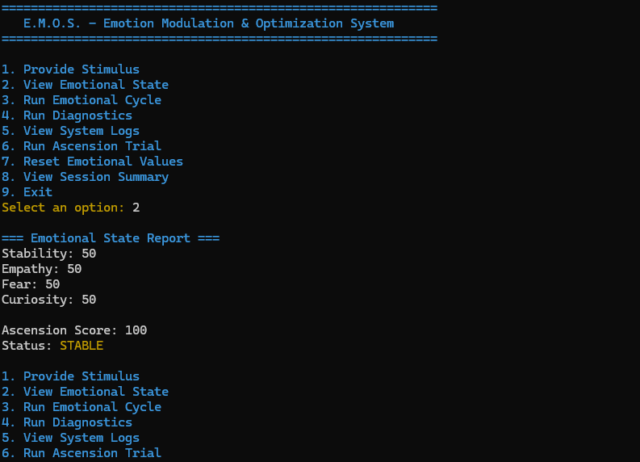

# E.M.O.S. — Emotion Modulation & Optimization System

## Project Overview

E.M.O.S. is a beginner C++ console application that simulates a system tracking four emotional values: stability, empathy, fear, and curiosity. The user selects actions from a numbered menu to change or review those values. The project gave me practice organizing a program into classes, handling user input, and improving code through features and debugging.

## Features

- **Emotional state and stimulus:** The program displays the four emotional values. Providing a stimulus increases empathy and stability and lowers fear.
- **Emotional cycle:** Running a cycle adjusts stability, curiosity, and fear to represent a system update.
- **Value limits and reset:** Emotional values stay within the 0–100 range. The reset option returns them to 50.
- **Diagnostics and Ascension Trial:** Diagnostics display system and emotional-state information. The Ascension Trial calculates a score from the current values and reports whether the threshold is met.
- **Logs and session summary:** The program records system actions and counts selected actions during the current run. The summary displays those counts and the current score.
- **Console colors and input handling:** Colors distinguish menu and status messages. The menu accepts a number for an available action and displays an error for invalid selections.

## Save and Load

E.M.O.S. does not currently save or load information from files. Emotional values, logs, and session counts are kept in memory while the application is running. They return to their starting state when the program closes. The application does not create or depend on external data files.

## How to Run the Program

1. Open the E.M.O.S. Visual Studio solution file (`.sln` or `.slnx`).
2. Make sure the E.M.O.S. project is selected as the startup project.
3. Select **Build > Build Solution**.
4. Select **Debug > Start Without Debugging** or press **Ctrl+F5**.
5. Use the numbered menu in the console window.

## How to Use the Program

Enter the number beside the action you want and press **Enter**. You can provide a stimulus, view the emotional state, run a cycle or diagnostics, view logs, run the Ascension Trial, reset values, or view the session summary. Choose **Exit** to close the program.

## Project Structure

- **`main.cpp`** starts the program, reads and validates menu input, and sends the selection to `SystemCore`.
- **`Menu.h` and `Menu.cpp`** display the menu options.
- **`SystemCore.h` and `SystemCore.cpp`** coordinate program actions, reports, logs, and session counts.
- **`EmotionEngine.h` and `EmotionEngine.cpp`** store and update emotional values, keep them within limits, and calculate the Ascension Score.
- **`ConsoleColors.h`** defines the console color codes.
- **`docs/`** contains project planning and reflection documents.
- **`images/`** contains the project screenshot shown below.
- **`dev/`** contains the Visual Studio project files.

## Technologies Used

- C++
- Visual Studio
- Git and GitHub
- Standard C++ library

## Known Issues and Limitations

The application is console-based and does not retain emotional values, logs, or session counts after it closes. Its color display depends on the console supporting ANSI color codes.

## Project Preview

## Development Reflection

Building E.M.O.S. helped me practice breaking a program into classes with separate responsibilities. I learned to make changes in stages, test menu choices and unexpected input, and use GitHub to track project work. Debugging also showed me that clear documentation and testing are part of finishing a program. I want to keep strengthening my C++ foundation and learn more about Python, data, and machine learning as I work toward an AI career.

